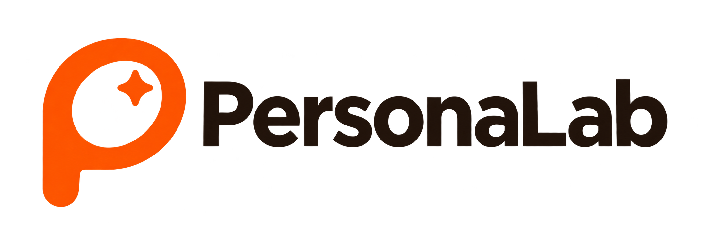
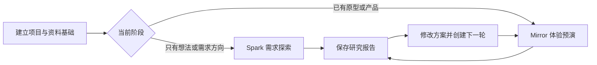

# PersonaLab

<p align="center">
  
</p>

<p align="center">
  <strong>帮助团队从发现真实用户需求、验证产品想法，到持续优化产品的 AI 产品研究与验证工作台。</strong>
</p>

<p align="center">
  <a href="https://u77-ovo.github.io/personalab/">在线体验</a>
  ·
  <a href="#快速上手">快速上手</a>
  ·
  <a href="#当前能力边界">能力边界</a>
  ·
  <a href="#本地运行">本地运行</a>
</p>

<p align="center">
  
  
  
  
</p>

> 当前公开版本是无需注册的浏览器本地 Demo。它用于体验产品流程、准备研究方案和展示项目概念；Spark 与 Mirror 当前使用固定本地逻辑生成示例结果，不调用真实大模型，也不能替代真人访谈、问卷或可用性测试。

## 在线体验

**公开地址：<https://u77-ovo.github.io/personalab/>**

| 项目 | 当前状态 |
| --- | --- |
| 当前版本 | V1.0 |
| 部署方式 | GitHub Pages |
| 使用方式 | 无需注册，打开即用 |
| 数据保存 | 当前浏览器 `localStorage` |
| 适用场景 | 产品流程体验、研究准备、方案展示、个人工作区 |

首次访问建议选择“打开示例项目”，快速查看 Workspace、Spark、Mirror、报告与多轮迭代的完整关系。准备录入自己的项目时，再选择“创建我的项目”。

## PersonaLab 是什么

PersonaLab 把产品研究中容易分散的项目、用户资料、Persona、需求探索、体验预演、报告和复测记录组织在同一套工作流中。

它主要解决四类问题：

- 研究材料、Persona、任务和报告分散，难以持续追踪；
- 只有产品想法时，不清楚应该先验证需求、用户分歧还是产品概念；
- 已有原型时，缺少统一的任务路径、问题优先级和体验评分框架；
- 每轮修改后的结果难以与上一轮对照，产品迭代容易失去证据链。

## 核心工作流



| 阶段 | 用户要做什么 | PersonaLab 的产出 |
| --- | --- | --- |
| 探索需求 | 整理用户问题、场景和已有资料 | 项目素材与 Persona 研究基础 |
| 验证概念 | 判断需求、分歧、风险与机会 | Spark 圆桌推演、需求机会、来源记录、概念建议 |
| 评估体验 | 检查原型或产品的核心任务路径 | Mirror 问题清单、八维评分、模拟路径与改进方向 |
| 持续优化 | 修改产品并重复验证 | 报告归档、下一轮草稿与轮次对比 |

## 主要功能

### Workspace 项目工作区

- 创建和管理多个产品研究项目；
- 按项目阶段、状态、标签和更新时间组织工作；
- 在单项目看板统一查看任务、素材和报告；
- 根据“想法—资料—原型—产品—上线迭代”阶段提示下一步行动；
- 支持项目归档、恢复和删除。

### Persona 用户库

Persona 是可跨项目复用的研究视角。当前提供六类预设 Persona：

- 目标明确的新用户；
- 效率导向的重度用户；
- 隐私敏感型用户；
- 低数字熟练度用户；
- 无障碍需求用户；
- 价格敏感型决策者。

用户也可以创建自定义 Persona，填写名称、行为与需求说明以及特征标签，并在 Spark 和 Mirror 中重复使用。

### Spark 需求探索

Spark 适合只有产品想法、研究方向或初步资料的阶段。

输入包括产品方向、目标问题、信息范围和至少两个 Persona；输出包括：

- 不同 Persona 的模拟圆桌讨论；
- 需求、共识、分歧、风险和机会；
- 原始资料片段、公开资料方向与证据缺口；
- 第一轮最小产品概念和后续验证建议。

Spark 会区分项目资料、Persona 推演和综合推断。未得到真实资料支持的内容仍属于待验证假设。

### Mirror 体验预演

Mirror 适合已有截图、流程、Figma 链接、网站、视频或文字流程说明的阶段。

它围绕一个核心任务和选定 Persona，输出：

- 用户任务路径；
- 问题清单和优先级；
- 模拟体验过程；
- 八维体验评分；
- 下一轮补充材料与修改建议。

八维体系包括任务清晰度、信息架构与可寻找性、交互一致性、系统反馈、认知负荷、错误预防与恢复、信任与隐私、Persona 适配与无障碍。证据不足的维度会显示“暂不评分”，不会被强行折算为总分。

### 报告与多轮迭代

- 自动保存 Spark 和 Mirror 结果；
- 按项目、类型和时间搜索或筛选报告；
- 预览关键发现和下一轮建议；
- 回到原始任务查看完整结果；
- 导出 Markdown 报告；
- 从报告创建下一轮草稿；
- 对比评分覆盖、问题数量和已改善项目。

### 本地数据管理

当前版本使用浏览器 `localStorage` 保存项目、任务、素材、报告、Persona、Spark 记录和 Mirror 记录，存储键为 `personalab.rebuild.demo.v1`。

- 刷新网页后可以恢复数据；
- 清理浏览器数据或更换设备后不会自动同步；
- 可以导出 JSON 作为本地备份；
- 导入 JSON 会替换当前浏览器中的 PersonaLab 数据；
- 清空数据会恢复为空白工作区，不影响已经导出的备份文件。

## 快速上手

1. 打开[在线 Demo](https://u77-ovo.github.io/personalab/)。
2. 首次体验选择“打开示例项目”；正式录入选择“创建我的项目”。
3. 填写项目名称、简介和当前阶段。
4. 在项目素材中录入访谈、问卷、用户评价、客服记录、行业或竞品资料的关键信息。
5. 使用预设 Persona，或在 Persona 用户库中创建自己的典型用户视角。
6. 只有想法时进入 Spark；已有原型或产品时进入 Mirror。
7. 查看来源证据、暂不评分维度和仍需真实验证的假设。
8. 将结果保存到报告归档，导出 Markdown 或创建下一轮草稿。
9. 定期在数据管理中导出 JSON，避免浏览器数据被清理后丢失。

## 当前能力边界

| 能力 | 当前状态 | 正确理解 |
| --- | --- | --- |
| 账号系统 | 未上线 | 无需登录，数据属于当前浏览器 |
| 云端数据库 | 未上线 | 刷新可恢复，但不能跨设备自动同步 |
| 真实 AI 调用 | 未上线 | Spark 和 Mirror 使用固定本地逻辑生成示例结果 |
| 联网检索 | 未上线 | 公开资料选项只记录待检索方向 |
| 文件上传与解析 | 未上线 | Mirror 只读取文件名等基础信号，不上传或解析内容 |
| 真实用户研究 | 不由网站自动完成 | 模拟结果只用于研究准备，仍需访谈、问卷或可用性测试 |
| 报告导出 | 已上线 Markdown | PDF 和批量导出尚未上线 |
| 协作与权限 | 未上线 | 当前适合单浏览器个人使用和现场演示 |

示例项目中的访谈人数、问卷比例、评分和用户反馈都是演示数据，不代表 PersonaLab 已经完成对应研究或验证。

## 本地运行

### 方式一：运行完整开发项目

环境要求：Node.js 24，npm。

```bash
git clone https://github.com/u77-ovo/personalab.git
cd personalab
npm install
npm run dev
```

打开 <http://localhost:3000>。

### 方式二：只运行静态 Demo

静态 Demo 位于 `public/demo/`。可以直接打开 `public/demo/index.html`，也可以在该目录启动任意静态服务器。

### 常用命令

```bash
npm run dev        # 启动本地开发环境
npm run lint       # 检查代码规范
npm run typecheck  # 检查 TypeScript 类型
npm run test       # 运行单元测试
npm run build      # 构建生产版本
npm run start      # 启动已构建的生产版本
```

## 项目结构

```text
personalab/
├─ .github/workflows/    # GitHub Actions 质量检查与 Pages 部署
├─ docs/                 # 架构决策、路线图、部署说明和测试证据
├─ public/demo/          # 当前公开的静态 Demo
├─ src/                  # Next.js 页面、组件、API 与业务逻辑
├─ supabase/             # 数据库迁移、RLS 策略与权限测试
├─ .env.example          # 环境变量示例，不包含真实密钥
├─ next.config.ts        # Next.js 配置
├─ package.json          # 依赖与运行命令
└─ tsconfig.json         # TypeScript 配置
```

## 技术栈

- 前端与应用框架：Next.js 16、React 19、TypeScript；
- 当前公开 Demo：HTML、CSS、JavaScript、浏览器 `localStorage`；
- 测试与质量：ESLint、TypeScript、Vitest、GitHub Actions；
- 后续云端底座：Supabase Auth、PostgreSQL、RLS、Private Storage；
- 后续 AI 接入：服务端模型调用、来源记录、额度限制和失败保护。

## 数据与隐私

- 不要将 API Key、数据库密码或 `.env.local` 提交到 GitHub；
- 不要把真实访谈、参与者身份、录音、视频或未匿名化研究材料放入公开仓库；
- 当前公开 Demo 不会上传用户选择的文件；
- 在账号权限、私有存储和双账号隔离测试完成前，不应向云端上传真实研究资料；
- AI 推断必须标记为待验证假设，不能冒充真人反馈或研究结论。

## 后续规划

1. 继续验证本地版的信息架构、任务流程、结果表达和报告迭代；
2. 接入登录、云端数据库和私有存储，完成双账号权限隔离；
3. 在安全底座验证完成后接入真实 AI 与联网检索；
4. 增加文件预览与解析、PDF 和批量报告导出；
5. 扩展团队协作、角色权限、操作记录和真实用户研究闭环。

详细工程路线见 [`docs/ROADMAP.md`](docs/ROADMAP.md)，部署边界见 [`docs/DEPLOYMENT_GUIDE.md`](docs/DEPLOYMENT_GUIDE.md)。

## 版本说明

- 当前公开版本：V1.0；
- 核验日期：2026 年 11 月 13 日；
- 部署环境：GitHub Pages；
- 当前定位：可公开体验的本地数据 Demo。

本仓库目前未声明开源许可证。未经明确许可，不代表允许将代码、设计或项目材料用于再发布或商业用途。
